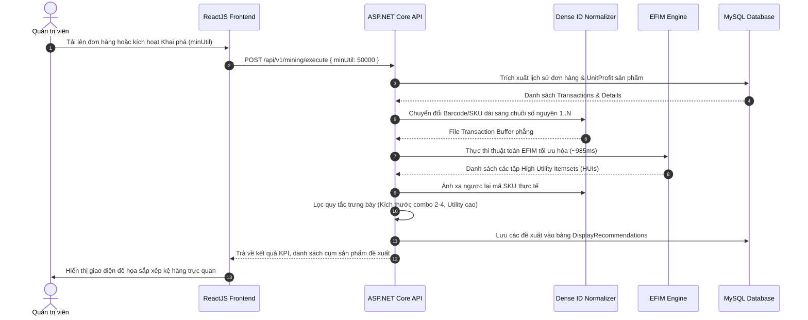

# TÀI LIỆU 03: KIẾN TRÚC HỆ THỐNG VÀ THIẾT KẾ PHẦN MỀM HỖ TRỢ SẮP XẾP HÀNG HÓA

---

## 1. Kiến trúc Tổng thể Hệ thống (System Architecture)

Hệ thống được thiết kế theo mô hình kiến trúc phân tầng chuẩn doanh nghiệp (**3-Tier Enterprise Architecture**) đảm bảo tính mở rộng (*Scalability*), tính bảo mật (*Security*), và khả năng tách biệt trách nhiệm (*Separation of Concerns*):

```
┌─────────────────────────────────────────────────────────────────────────────┐
│                      TẦNG TRÌNH DIỄN (FRONTEND TIER)                        │
│                 ReactJS 18 + TailwindCSS + Ant Design + Vite                │
│  ┌───────────────────────┬───────────────────────┬───────────────────────┐  │
│  │   Admin Dashboard     │  Product & Category   │   Transaction Orders  │  │
│  │   & Mining KPIs       │  Management Module    │   Data Import (CSV)   │  │
│  ├───────────────────────┼───────────────────────┼───────────────────────┤  │
│  │  HUPM Mining Studio   │  Shelf Layout Visual  │  Smart Bundle &       │  │
│  │  (minUtil, Run EFIM)  │  Arrangement Planner  │  Cross-sell Showcase  │  │
│  └───────────────────────┴───────────────────────┴───────────────────────┘  │
└──────────────────────────────────────┬──────────────────────────────────────┘
                                       │ REST API (JSON / JWT)
┌──────────────────────────────────────▼──────────────────────────────────────┐
│                       TẦNG ỨNG DỤNG (BACKEND TIER)                          │
│                          ASP.NET Core 8 Web API                             │
│  ┌───────────────────────────────────────────────────────────────────────┐  │
│  │  API Controllers: AuthController, ProductController, MiningController │  │
│  ├───────────────────────────────────────────────────────────────────────┤  │
│  │  Service Layer: ProductService, IngestionService, PlacementService    │  │
│  ├───────────────────────────────────────────────────────────────────────┤  │
│  │  Dense ID Normalizer: Chuyển đổi mã SKU thưa sang dải số 1..N         │  │
│  ├───────────────────────────────────────────────────────────────────────┤  │
│  │  Mining Engine Bridge: Thực thi EFIM tối ưu hóa (Sub-1s runtime)     │  │
│  ├───────────────────────────────────────────────────────────────────────┤  │
│  │  Data Access Layer: Entity Framework Core 8 / Dapper ORM              │  │
│  └───────────────────────────────────────────────────────────────────────┘  │
└──────────────────────────────────────┬──────────────────────────────────────┘
                                       │ SQL Connection Pool
┌──────────────────────────────────────▼──────────────────────────────────────┐
│                       TẦNG DỮ LIỆU (DATABASE TIER)                          │
│                              MySQL 8.0 DBMS                                 │
│  ┌────────────────────────┬────────────────────────┬─────────────────────┐  │
│  │  Catalog: Products,    │  Orders: Transactions, │  Mining Results:    │  │
│  │  Categories, Inventory │  TransactionDetails    │  HUIs, Placements   │  │
│  └────────────────────────┴────────────────────────┴─────────────────────┘  │
└─────────────────────────────────────────────────────────────────────────────┘
```

---

## 2. Luồng Dữ liệu Toàn trình (End-to-End Data Pipeline)

Quá trình từ dữ liệu giao dịch bán hàng thô đến khi xuất hiện đề xuất sắp xếp hàng hóa trên website trải qua 6 bước khép kín:



---

## 3. Thiết kế Chi tiết Cơ sở Dữ liệu (Database Schema DDL)

Toàn bộ kịch bản tạo bảng (*Data Definition Language - DDL*) trên cơ sở dữ liệu MySQL 8.0:

```sql
-- ============================================================================
-- 1. TẠO CƠ SỞ DỮ LIỆU VÀ CẤU HÌNH BẢNG MÃ UTF-8
-- ============================================================================
CREATE DATABASE IF NOT EXISTS OnlineRetailDSS
CHARACTER SET utf8mb4 
COLLATE utf8mb4_unicode_ci;

USE OnlineRetailDSS;

-- ============================================================================
-- 2. QUẢN LÝ NGƯỜI DÙNG VÀ PHÂN QUYỀN (USER MANAGEMENT)
-- ============================================================================
CREATE TABLE Users (
    Id INT AUTO_INCREMENT PRIMARY KEY,
    Username VARCHAR(50) NOT NULL UNIQUE,
    Email VARCHAR(100) NOT NULL UNIQUE,
    PasswordHash VARCHAR(255) NOT NULL,
    FullName VARCHAR(100) NOT NULL,
    Role VARCHAR(20) NOT NULL DEFAULT 'Manager', -- 'Admin', 'Manager', 'Staff'
    IsActive BOOLEAN DEFAULT TRUE,
    CreatedAt DATETIME DEFAULT CURRENT_TIMESTAMP,
    UpdatedAt DATETIME DEFAULT CURRENT_TIMESTAMP ON UPDATE CURRENT_TIMESTAMP
);

-- ============================================================================
-- 3. QUẢN LÝ DANH MỤC VÀ SẢN PHẨM (CATALOG MANAGEMENT)
-- ============================================================================
CREATE TABLE Categories (
    Id INT AUTO_INCREMENT PRIMARY KEY,
    Name VARCHAR(100) NOT NULL UNIQUE,
    Description TEXT,
    DisplayOrder INT DEFAULT 0,
    CreatedAt DATETIME DEFAULT CURRENT_TIMESTAMP
);

CREATE TABLE Products (
    Id INT AUTO_INCREMENT PRIMARY KEY,
    Sku VARCHAR(50) NOT NULL UNIQUE,
    Name VARCHAR(255) NOT NULL,
    CategoryId INT NOT NULL,
    CostPrice DECIMAL(18, 2) NOT NULL,
    SellingPrice DECIMAL(18, 2) NOT NULL,
    UnitProfit DECIMAL(18, 2) GENERATED ALWAYS AS (SellingPrice - CostPrice) STORED,
    StockQuantity INT NOT NULL DEFAULT 0,
    ImageUrl VARCHAR(500),
    Status VARCHAR(20) DEFAULT 'Active', -- 'Active', 'Discontinued'
    CreatedAt DATETIME DEFAULT CURRENT_TIMESTAMP,
    UpdatedAt DATETIME DEFAULT CURRENT_TIMESTAMP ON UPDATE CURRENT_TIMESTAMP,
    FOREIGN KEY (CategoryId) REFERENCES Categories(Id) ON DELETE RESTRICT
);

-- ============================================================================
-- 4. QUẢN LÝ GIAO DỊCH ĐƠN HÀNG (TRANSACTION MANAGEMENT)
-- ============================================================================
CREATE TABLE Transactions (
    Id INT AUTO_INCREMENT PRIMARY KEY,
    OrderCode VARCHAR(50) NOT NULL UNIQUE,
    TotalAmount DECIMAL(18, 2) NOT NULL,
    TotalUtility DECIMAL(18, 2) NOT NULL,
    TransactionDate DATETIME NOT NULL,
    CreatedAt DATETIME DEFAULT CURRENT_TIMESTAMP
);

CREATE TABLE TransactionDetails (
    Id INT AUTO_INCREMENT PRIMARY KEY,
    TransactionId INT NOT NULL,
    ProductId INT NOT NULL,
    Quantity INT NOT NULL,
    UnitPrice DECIMAL(18, 2) NOT NULL,
    UnitCost DECIMAL(18, 2) NOT NULL,
    Utility DECIMAL(18, 2) NOT NULL, -- (UnitPrice - UnitCost) * Quantity
    FOREIGN KEY (TransactionId) REFERENCES Transactions(Id) ON DELETE CASCADE,
    FOREIGN KEY (ProductId) REFERENCES Products(Id) ON DELETE RESTRICT
);

-- ============================================================================
-- 5. LỊCH SỬ PHIÊN KHAI PHÁ DỮ LIỆU (MINING MODULE)
-- ============================================================================
CREATE TABLE MiningJobs (
    Id INT AUTO_INCREMENT PRIMARY KEY,
    AlgorithmName VARCHAR(50) NOT NULL, -- 'EFIM' hoặc 'HUI-Miner'
    MinUtilityThreshold DECIMAL(18, 2) NOT NULL,
    DatasetName VARCHAR(100) NOT NULL,
    TotalTransactions INT NOT NULL,
    DiscoveredHuiCount INT NOT NULL,
    ExecutionTimeMs INT NOT NULL,
    MemoryConsumedMb DECIMAL(10, 2) NOT NULL,
    Status VARCHAR(20) NOT NULL DEFAULT 'Completed', -- 'Running', 'Completed', 'Failed'
    ExecutedBy INT NOT NULL,
    ExecutedAt DATETIME DEFAULT CURRENT_TIMESTAMP,
    FOREIGN KEY (ExecutedBy) REFERENCES Users(Id)
);

CREATE TABLE HighUtilityItemsets (
    Id INT AUTO_INCREMENT PRIMARY KEY,
    MiningJobId INT NOT NULL,
    ItemCount INT NOT NULL,
    CalculatedUtility DECIMAL(18, 2) NOT NULL,
    ItemIdsJson JSON NOT NULL, -- Lưu danh sách ID sản phẩm dạng mảng JSON [1, 5, 8]
    CreatedAt DATETIME DEFAULT CURRENT_TIMESTAMP,
    FOREIGN KEY (MiningJobId) REFERENCES MiningJobs(Id) ON DELETE CASCADE
);

-- ============================================================================
-- 6. ĐỀ XUẤT SẮP XẾP TRƯNG BÀY (RECOMMENDATION & ARRANGEMENT MODULE)
-- ============================================================================
CREATE TABLE DisplayRecommendations (
    Id INT AUTO_INCREMENT PRIMARY KEY,
    AnchorProductId INT NOT NULL,
    RecommendedProductId INT NOT NULL,
    HuiId INT NOT NULL,
    PlacementStrategy VARCHAR(50) NOT NULL, -- 'Adjacent_PDP', 'Combo_Banner', 'Checkout_Upsell'
    UtilityScore DECIMAL(18, 2) NOT NULL,
    IsActive BOOLEAN DEFAULT TRUE,
    ApprovedBy INT,
    UpdatedAt DATETIME DEFAULT CURRENT_TIMESTAMP ON UPDATE CURRENT_TIMESTAMP,
    FOREIGN KEY (AnchorProductId) REFERENCES Products(Id) ON DELETE CASCADE,
    FOREIGN KEY (RecommendedProductId) REFERENCES Products(Id) ON DELETE CASCADE,
    FOREIGN KEY (HuiId) REFERENCES HighUtilityItemsets(Id) ON DELETE CASCADE,
    FOREIGN KEY (ApprovedBy) REFERENCES Users(Id)
);
```

---

## 4. Thiết kế Chi tiết REST API (ASP.NET Core Web API)

### 4.1. Kích hoạt tác vụ khai phá HUPM
- **Endpoint**: `POST /api/v1/mining/execute`
- **Request Body**:
  ```json
  {
    "algorithm": "EFIM",
    "minUtility": 50000.00,
    "datasetSource": "CurrentDatabase"
  }
  ```
- **Response Body**:
  ```json
  {
    "success": true,
    "jobId": 104,
    "algorithm": "EFIM",
    "executionTimeMs": 985,
    "memoryConsumedMb": 22.92,
    "discoveredHuiCount": 1051,
    "message": "Mining completed successfully in sub-second response time."
  }
  ```

### 4.2. Lấy danh sách đề xuất sắp xếp hàng hóa trưng bày
- **Endpoint**: `GET /api/v1/recommendations/arrangement?strategy=Adjacent_PDP&limit=20`
- **Response Body**:
  ```json
  {
    "total": 20,
    "items": [
      {
        "id": 1,
        "anchorProduct": {
          "id": 102,
          "sku": "LAP-MAC-M3",
          "name": "MacBook Pro M3 14 inch",
          "price": 42000000.00
        },
        "recommendedProduct": {
          "id": 305,
          "sku": "ACC-HUB-10IN1",
          "name": "USB-C Hub 10-in-1 HyperDrive",
          "price": 2100000.00
        },
        "placementStrategy": "Adjacent_PDP",
        "utilityContribution": 1450000.00,
        "explanation": "Cặp sản phẩm này đóng góp lợi nhuận cao trong 842 đơn hàng gần nhất."
      }
    ]
  }
  ```

---

## 5. Chiến lược Chuyển đổi High Utility Itemsets sang Bố trí Trưng bày

Không phải mọi tập HUI tìm được đều có thể đưa lên website trực tiếp. Tầng nghiệp vụ (*Business Logic*) của hệ thống áp dụng 4 bộ lọc chiến lược:

1. **Bộ lọc kích thước tập mẫu ($k \in [2, 4]$)**:
   - Các tập 1 mặt hàng chỉ là bán lẻ đơn thuần.
   - Các tập từ 5 mặt hàng trở lên quá dài, không khả thi để đóng gói combo hoặc hiển thị trên giao diện màn hình điện thoại di động.
   - Tập tối ưu nhất để trưng bày là **2 đến 3 sản phẩm**.

2. **Quy tắc Trưng bày Liền kề trên PDP (Product Detail Page Co-location)**:
   - Khi khách hàng xem sản phẩm $A$, widget *"Thường được mua cùng"* sẽ tự động hiển thị sản phẩm $B$ (với điều kiện $\{A, B\} \subseteq HUI$).
   - Kèm nút bấm: *"Mua cả combo để được ưu đãi 5%"*.

3. **Gợi ý Bán gia tăng tại trang Giỏ hàng (Smart Checkout Upsell)**:
   - Khi giỏ hàng hiện có sản phẩm $A$ và $B$, thuật toán kiểm tra trong bảng `HighUtilityItemsets` xem có tập con $\{A, B, C\}$ nào có Utility lớn hay không.
   - Nếu có, sản phẩm $C$ sẽ được gợi ý ngay dưới nút "Tiến hành thanh toán" kèm thông điệp kích cầu.

4. **Sắp xếp Lưới Danh mục Hàng hóa (Category Grid Arrangement)**:
   - Trong trang danh mục tổng, các sản phẩm nằm trong cùng một tập HUI được ưu tiên xếp ở các ô liền kề nhau trên cùng một hàng ngang để tối đa hóa khả năng nhận diện thị giác của khách hàng.
